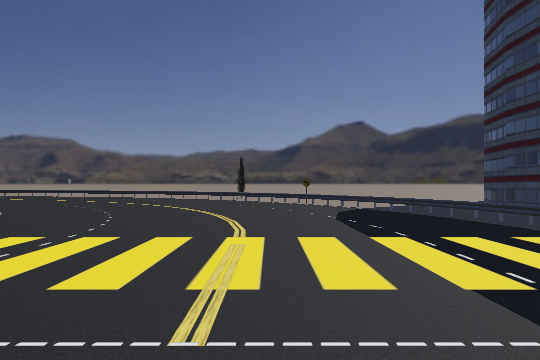

# Self-Driving Car Control with Reinforcement Learning

**An experimental autonomous-driving control project in the Webots simulator**, combining proximal policy optimization (PPO), camera-based visual features, LiDAR sensing, and a highway-overtaking simulation with SUMO-related controllers.



> **Status:** research / simulation prototype. This repository is **not** a deployable autonomous-driving system. Training, safety, and performance claims have not been independently verified.

## Overview

This repository preserves an iterative implementation of reinforcement-learning-based vehicle control. Its scripts use **Stable-Baselines3 PPO**, **Gymnasium**, and **Webots**. Camera features are extracted using either a small CNN or a pretrained **ResNet-18** backbone, while later stages incorporate LiDAR information. The final stage includes a Webots world with highway-overtaking controllers and SUMO integration resources.

### Development phases

| Phase | Source | Focus |
| --- | --- | --- |
| **1: CNN** | [`phase1_CNN.py`](phase1_CNN.py) | Camera features and PPO-based vehicle steering in Webots. Requires a separately generated CNN `.h5` file. |
| **1: ResNet** | [`phase1_Resnet/vehicle_driver.py`](phase1_Resnet/vehicle_driver.py) | ResNet-18 visual features feeding a PPO controller. |
| **2: CNN** | [`phase2_CNN/`](phase2_CNN/) | Camera + LiDAR-oriented training/evaluation scripts, CNN model notebook, and plots. |
| **2: ResNet** | [`phase2_Resnet/`](phase2_Resnet/) | ResNet-based perception with two-dimensional steering/speed action space. |
| **3: Highway overtaking** | [`phase3_Resnet/`](phase3_Resnet/) | A Webots `.wbt` world, PPO controller, distance sensors, and SUMO supervisor/route configuration. |

The phases reflect the original archive's structure. They are **separate experimental scripts**, not a single consolidated training pipeline.

## Repository layout

```text
.
├── phase1_CNN.py
├── phase1_Resnet/
│   └── vehicle_driver.py
├── phase2_CNN/
│   ├── CNN_Model_Generater.ipynb
│   ├── train.py
│   ├── test.py
│   ├── plotter.py
│   └── images/
├── phase2_Resnet/
│   ├── vehicle_driver.py
│   └── plotter.py
├── phase3_Resnet/
│   ├── controllers/
│   ├── plugins/robot_windows/
│   └── worlds/highway_overtake.wbt
├── docs/
│   ├── GETTING_STARTED.md
│   ├── PROJECT_NOTES.md
│   └── THIRD_PARTY.md
├── tests/
├── requirements.txt
└── .github/workflows/ci.yml
```

## Getting started

### Prerequisites

- **Webots** with Python controller support. The `vehicle` and `controller` modules are provided by Webots, **not** by pip.
- **Python** with an environment compatible with your Webots installation.
- **SUMO** for the highway-world integration that uses the SUMO supervisor.
- Camera/LiDAR devices and model weights required by the specific phase.

```bash
# From the extracted project directory; after GitHub publication, cloning is also possible.
cd self-driving-car-control-rl
python -m venv .venv
# Activate .venv using your platform's standard activation command.
python -m pip install -r requirements.txt
```

Open [`phase3_Resnet/worlds/highway_overtake.wbt`](phase3_Resnet/worlds/highway_overtake.wbt) **in Webots** to inspect the included simulation world. Configure the Webots Python controller interpreter, SUMO environment, and selected controller before starting the simulation. The earlier phase scripts also need to be configured as Webots controllers. They cannot be launched as ordinary system Python scripts without the simulator-provided `controller` / `vehicle` modules.

For stage-specific details and model-file dependencies, see **[Getting Started](docs/GETTING_STARTED.md)**.

## Learning and control approach

The project experiments with a continuous-action **PPO** policy trained through Stable-Baselines3. Its Gymnasium environment reads simulated sensor observations, extracts visual features with a CNN or ResNet-18, obtains a steering and/or speed control action, steps Webots, and calculates rewards based on the stage-specific control logic.

The implementation changes across phases; there is no claim that one single observation, action, or reward design applies to all scripts. See [Project Notes](docs/PROJECT_NOTES.md) for a code-grounded phase comparison.

## How to validate the repository

The included dependency-free checks verify Python **syntax**, source-file structure, notebook JSON integrity, and presence of simulation assets:

```bash
python -m unittest discover -s tests -v
```

This check **does not** launch Webots, train a PPO agent, evaluate driving accuracy, or confirm that all dependencies are mutually compatible. GitHub Actions runs the same basic checks on each push and pull request.

## Results and limitations

The uploaded source archive contains code, simulation assets, an example road image, and a notebook. It does **not** contain complete trained PPO checkpoint files, recorded evaluation metrics, or sufficient environment/version details to make reliable numerical claims about lane-keeping accuracy, collision rates, or overtaking success. Such results are intentionally **not fabricated here**.

In addition, some scripts refer to CNN `.h5` files and saved PPO policies that are not present. ResNet-based phases request pretrained weights, which may require a compatible cache or download. The project has not been verified end-to-end in a live Webots/SUMO session in this environment.

## Reproducibility and credits

- [Getting Started](docs/GETTING_STARTED.md) lists simulator requirements and stage entry points.
- [Project Notes](docs/PROJECT_NOTES.md) summarizes the real code and known reproducibility gaps.
- [Third-party notices](docs/THIRD_PARTY.md) documents the Cyberbotics-derived source and its existing copyright headers.
- [Contributing](CONTRIBUTING.md) and [Security](SECURITY.md) describe development conventions and simulation-only safety limits.

**Licensing note:** This archive includes files carrying **Cyberbotics Apache-2.0 notices**, but the licensing status of all remaining original project content is not specified. The repository is not assigned a blanket license without the rights holder's approval.
